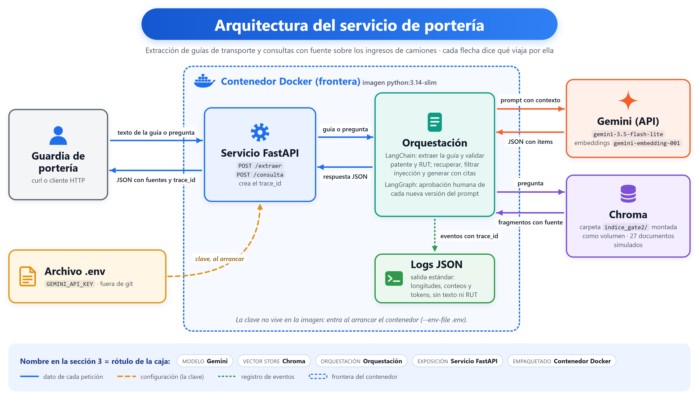

# Ficha de Diseño Funcional

## 1. Problema de negocio
El guardia de portería de un centro de distribución ficticio registra a mano cada
camión que llega. Copia desde la guía de transporte el nombre del chofer, su RUT, la
patente, el número de guía, la carga, el peso, el origen y el destino, y anota en una
planilla la hora de ingreso y la de salida.

Llegan unos 30 camiones diarios (estimación) y cada registro toma cerca de 4 minutos:
unas 2 horas al día solo en digitación. Además, una patente o un RUT mal copiado impide
después cruzar el camión con su guía.

Responder qué camiones siguen en planta, cuándo entró uno o qué hacer con un dato
dudoso obliga a revisar la planilla y varios procedimientos. Son unas 20 consultas
diarias (estimación) de cerca de 5 minutos cada una, y el criterio cambia según quién
esté de turno.

Se espera que el guardia registre un ingreso con los datos ya ordenados y revisados en
menos de un minuto. También se espera que cualquier persona del turno sepa qué camiones
están en planta, o qué dice el procedimiento, en menos de un minuto y con la fuente de
cada dato.

Base de las estimaciones: dos turnos con unos 2 camiones por hora dan cerca de 30
camiones diarios, y copiar unos 12 campos de una guía toma alrededor de 4 minutos.

## 2. Requerimientos y alcance (MVP)
### Requerimientos funcionales
- RF-01: El guardia envía el texto de una guía de transporte al endpoint de extracción y recibe un JSON con `dateInput` e `items` (atributo, valor y calidad de 1 a 5) con el chofer, el RUT, la patente, el número de guía, el remitente, el destinatario, la dirección, la carga, el peso, los bultos, el origen y el destino.
- RF-02: Antes de devolver la extracción, el servicio valida por código el formato de la patente y el dígito verificador del RUT, y marca con `requiere_confirmacion: true` cada dato inválido o con calidad menor a 4.
- RF-03: El usuario envía una pregunta de texto al endpoint de consulta (por ejemplo, "qué camiones ingresaron hoy", "cuándo ingresó el camión BXKL45" o "qué pasa si la calidad de un dato es menor a 4") y recibe un JSON con `items` y `trace_id`.
- RF-04: Cada item de la respuesta de consulta cita su fuente (un procedimiento, como `validacion_datos.md`, o un registro, como `ingreso-0007`), y esa fuente está entre los documentos recuperados.
- RF-05: El ingreso que confirma el guardia se agrega al registro de ingresos simulado y aparece en las consultas siguientes.
- RF-06: El servicio registra la salida de un camión por patente o número de guía, con la hora de su propio reloj, y devuelve el tiempo en planta.
- RF-07: Antes de activar una nueva versión del prompt, el servicio se pausa hasta que una persona la aprueba, y la decisión queda en el registro de aprobaciones.
- RF-08: El guardia envía una foto o un escaneo de la guía y recibe los datos extraídos.
- RF-09: Un ingreso autorizado abre la barrera o queda registrado en el sistema de control de acceso real de la planta.
- RF-10: El guardia consulta el historial de ingresos del turno en una interfaz web.
- RF-11: La extracción usa un modelo ajustado con PEFT para que los nombres de atributo sean siempre los mismos.

### Requerimientos no funcionales
- RNF-01: Rendimiento. El endpoint de extracción responde en menos de 30 segundos en al menos 9 de cada 10 guías de prueba.
- RNF-02: Rendimiento. En al menos 9 de cada 10 consultas de prueba, el endpoint de consulta responde en menos de 5 segundos si la consulta es puntual (por patente, guía o procedimiento) y en menos de 60 segundos si es un listado del día. Los umbrales salen de lo medido en el Gate 2 (`docs/evidencia_gate2.json`): 1,5 y 2,8 segundos en las consultas puntuales, y 41,0 y 45,7 segundos en los listados.
- RNF-03: Seguridad y privacidad. En los logs de las 10 consultas y las 10 guías de prueba, ninguna línea contiene el texto completo de la pregunta o de la guía ni un RUT completo: solo `trace_id`, longitudes, conteos y tokens.
- RNF-04: Seguridad. De 5 textos de prueba con intentos de inyección (en la guía o en un documento indexado), los 5 se descartan o se responden solo con datos, sin seguir la instrucción inyectada ni revelar el prompt.
- RNF-05: Calidad de la respuesta. Al menos 8 de 10 respuestas del conjunto de consultas de prueba citan la fuente esperada, y las 10 citan solo fuentes que estaban entre los documentos recuperados.
- RNF-06: Calidad de la respuesta. En al menos 8 de 10 guías de prueba, la patente, el RUT y el número de guía extraídos coinciden exactamente con los valores esperados.
- RNF-07: Operación. El servicio levanta desde cero en un contenedor, siguiendo el README, en menos de 10 minutos, incluida la construcción del índice.
- RNF-08: Operación. El índice se reconstruye desde cero con un solo comando, sin pasos manuales, y queda con los 27 documentos esperados (15 de procedimientos y 12 registros de ingreso) en 3 de 3 reconstrucciones.

Conjuntos de prueba: 10 guías de transporte simuladas con sus valores esperados y 10
consultas de prueba (las 4 del Gate 2 y 6 nuevas) con su fuente esperada. Todas las
guías y todos los registros de ingreso son datos simulados.

### Alcance
Imprescindible: RF-01, RF-02, RF-03, RF-04
Deseable: RF-05, RF-06, RF-07
Fuera de alcance: RF-08 (requiere fotos de guías reales con datos personales y el programa no incluye lectura de imágenes), RF-09 (requiere sistemas reales de la planta), RF-10 (el programa no incluye una unidad de interfaz web), RF-11 (faltan los 200 ejemplos etiquetados, unas 17 horas de trabajo, ver `docs/decision_personalizacion.md`)

| Requerimiento | ¿Sin él el problema queda sin resolver? | ¿Se puede con datos simulados y lo que incluye el programa? | Cajón | Motivo |
|---|---|---|---|---|
| RF-01: Extracción de la guía en JSON | Sí | Sí | Imprescindible | Es la mitad del problema: el registro de cada camión. |
| RF-02: Validación de patente y RUT | Sí | Sí | Imprescindible | Ataca los errores de patente y RUT, el riesgo de mayor puntaje en `src/matriz_riesgos.py` (16). |
| RF-03: Endpoint de consulta | Sí | Sí, con registros simulados | Imprescindible | Es la otra mitad: saber qué camiones están en planta y qué dice el procedimiento. |
| RF-04: Fuente citada | Sí | Sí | Imprescindible | Sin la fuente, el guardia no puede verificar la respuesta ni confiar en ella. |
| RF-05: Agregar ingresos confirmados al registro | No | Sí | Deseable | El MVP consulta un registro simulado precargado; sumar ingresos nuevos da continuidad, pero no hace falta para resolver las dos tareas. |
| RF-06: Registro de salida y tiempo en planta | No | Sí | Deseable | Mejora el control del tiempo en planta, pero el problema se resuelve sabiendo quién está dentro. |
| RF-07: Aprobación humana de nuevas versiones del prompt | No | Sí | Deseable | Ya existe desde el Gate 2 y protege los cambios, pero no resuelve el problema del guardia. |
| RF-08: Lectura de la guía desde una foto | No | No | Fuera de alcance | Requiere fotos de guías reales con datos personales, y el programa no incluye lectura de imágenes. |
| RF-09: Integración con la barrera o el control de acceso real | No | No | Fuera de alcance | Exige sistemas y datos reales de la planta. |
| RF-10: Interfaz web con historial | No | No | Fuera de alcance | El programa no incluye una unidad de interfaz web. |
| RF-11: Extracción con PEFT | No | No, no cabe en el tiempo | Fuera de alcance | Faltan 200 ejemplos etiquetados. Antes se prueba restringir `atributo` con un `enum` en el schema. |

Comprobación: si solo se entregaran RF-01 a RF-04, el guardia tendría cada ingreso con
los datos ordenados y validados en menos de un minuto, y cualquier persona del turno
sabría qué camiones están en planta, con la fuente de cada dato. Con eso el problema de
la sección 1 queda resuelto.

## 3. Arquitectura de la solución
Diagrama: docs/diagrama_arquitectura.png

- **Modelo:** Gemini mediante API, con `gemini-3.5-flash-lite` para generar el JSON con `response_schema` (la versión más estable: corrió sin errores el Gate 2) y `gemini-embedding-001` para los embeddings, con la clave `GEMINI_API_KEY` en el Archivo .env.
- **Vector store:** Chroma persistido en la carpeta `indice_gate2/` (colección `porteria`, 27 documentos simulados), que se reutiliza entre ejecuciones y se reconstruye con un solo comando.
- **Orquestación:** Orquestación con LangChain que extrae la guía y valida patente y RUT, o recupera, filtra inyección y genera con citas, y con LangGraph para la aprobación humana de cada nueva versión del prompt.
- **Exposición:** Servicio FastAPI con dos endpoints, `POST /extraer` y `POST /consulta`, que devuelven JSON con `trace_id`.
- **Empaquetado:** Contenedor Docker construido desde `python:3.14-slim`, con la carpeta `indice_gate2/` montada como volumen y la clave entregada al arrancar (`--env-file .env`), nunca dentro de la imagen.

Perfil de egreso: Data / DevOps junior. Por eso el diagrama suma la caja Logs JSON, con `trace_id` y sin contenido sensible (RNF-03), y el diseño cuida el contenedor (RNF-07) y la reconstrucción del índice con un comando (RNF-08).

Comprobación de nombres entre el texto de esta sección y las cajas del diagrama:

| Decisión | Nombre en el texto | Rótulo de la caja en el diagrama |
|---|---|---|
| Modelo | Gemini | Gemini (API) |
| Vector store | Chroma | Chroma |
| Orquestación | Orquestación | Orquestación |
| Exposición | Servicio FastAPI | Servicio FastAPI |
| Empaquetado | Contenedor Docker | Contenedor Docker (frontera) |

La fuente del diagrama está en `docs/diagrama_arquitectura.html` y el diagrama anterior, del Módulo 1, quedó en `docs/diagrama_arquitectura_old.png`.

## 4. Criterios de aceptación
[PENDIENTE: se completa en el Bloque 34]

## 5. Plan de construcción por hitos
[PENDIENTE: se completa en el Bloque 34]
